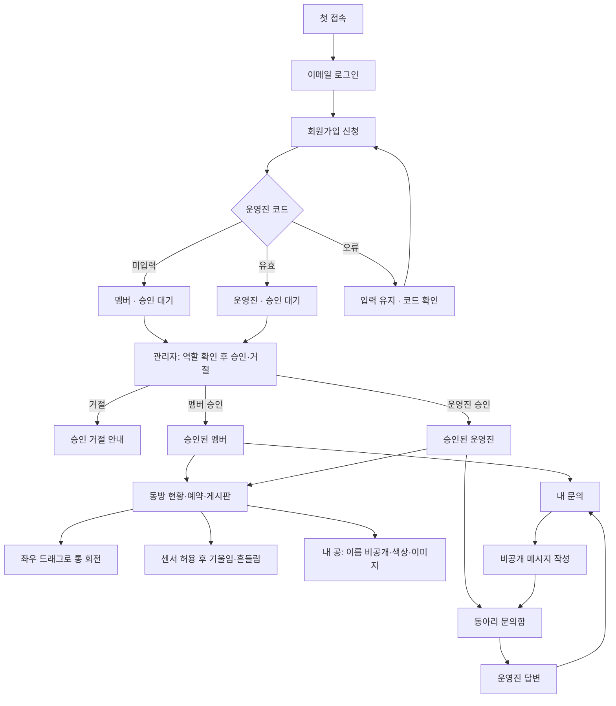

## v10 계정·운영·개인화

운영진(operator)은 문의 답변과 운영진 코드 변경을, 관리자(admin)는 여기에 회원 승인·거절을 처리합니다. 승인 전 계정에는 현황·예약·게시판·문의·명단을 열지 않습니다. 역할 변경/403 시 화면 데이터를 지우고 권한을 다시 확인합니다. 서버 권한과 초기 설정은 AUTH.md에 명시했습니다.

운영진·관리자: 설정 → 운영진 가입 코드 → 새 코드·확인·본인 비밀번호 → 서버 검증 → 새 코드 적용. 이전 코드로 제출한 가입은 거절됩니다. 다른 운영진이 먼저 바꾸면 다시 불러오도록 안내합니다.

첫 HTML 표시부터 SAI 로고 로딩 화면 → 세션 확인 → 로그인 또는 승인된 앱. 서버 연결 오류에는 재시도를 표시하고 예시 데이터로 전환하지 않습니다.
